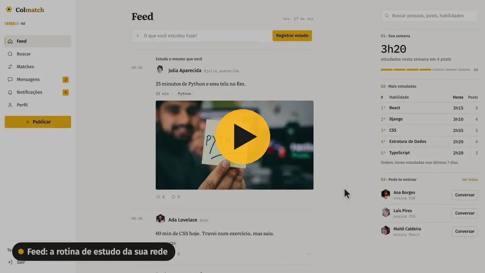

# Colmatch

**Troque o que você sabe pelo que você quer aprender.** Uma rede social de troca de habilidades
para iniciantes em tecnologia.

[](https://miniproj3.vercel.app/demo/colmatch-demo.mp4)

**[Abrir o Colmatch](https://miniproj3.vercel.app)** · [Ver a demo (46 s)](https://miniproj3.vercel.app/demo/colmatch-demo.mp4) ·
[Decisões do time](DECISIONS.md) · [Roteiro para a banca](docs/AVALIACAO.md)

## O que é e para quem

Quem começa em tecnologia (universitários nos primeiros períodos, alunos de bootcamp e quem está
migrando de área) estuda sozinho, trava e não tem a quem perguntar. Aula particular é cara, e o
tutorial não cobre a dúvida. Ao mesmo tempo, essa pessoa já sabe alguma coisa que outra quer
aprender.

No Colmatch, cada pessoa diz o que sabe e o que quer aprender. A rede mostra quem pode te ensinar e,
em destaque, com quem dá para trocar ("te ensino React, você me ensina Cálculo 1"). As duas pessoas
conversam, agendam a troca e se avaliam depois. A rotina de estudo postada no feed mostra que a
pessoa estuda aquilo de verdade. O porquê de cada escolha está no [DECISIONS.md](DECISIONS.md#produto).

## O que dá para fazer

- Criar conta e montar o perfil com o que sabe e o que quer aprender, escolhendo do catálogo com
  autocomplete (a IA só traduz o que foi digitado para um item do catálogo).
- Registrar o estudo do dia em posts com habilidade, tempo e foto; curtir, comentar e manter a
  sequência de dias.
- Seguir pessoas e acompanhar um feed com os próprios posts, os de quem segue e os de quem estuda o
  mesmo ou pode ensinar.
- Ver os matches em dois níveis: **Pares de troca** (troca recíproca) e **Pode te ensinar**.
- Conversar, propor e confirmar uma troca com horário, levá-la ao Google Agenda e avaliá-la depois
  que acontecer.
- Receber notificações e buscar pessoas, posts e habilidades.

## Deploy

| Parte | Onde |
|---|---|
| Frontend (Next.js) | [miniproj3.vercel.app](https://miniproj3.vercel.app), na Vercel |
| Backend (FastAPI) | Render, com o banco PostgreSQL no Neon ([decisões 13 e 15](DECISIONS.md#todas-as-decisões)) |

No plano gratuito do Render, a primeira requisição depois de um tempo parado pode levar cerca de
um minuto.

## Contas de demonstração

O `make seed` cria 32 pessoas com habilidades, posts de estudo (metade com foto), follows, conversas
e trocas; o banco do deploy partiu desse mesmo seed e hoje tem também as contas criadas por quem
testou. Entre com `ada`, `linus` ou `grace`; a senha de todas as contas do seed
é `senha-forte-123` (`SENHA_SEED` em [`backend/scripts/seed.py`](backend/scripts/seed.py)). `ada` e
`linus` formam o primeiro par de troca recíproca do seed.

## Como rodar localmente

Requisitos: Python 3.12 ([`backend/.python-version`](backend/.python-version)), Node.js 22
([`frontend/.nvmrc`](frontend/.nvmrc)), [uv](https://docs.astral.sh/uv/) e npm.

```bash
(cd backend && uv sync)
(cd frontend && npm install && cp .env.local.example .env.local)
make check      # confere o ambiente
make seed       # popula um banco vazio (SQLite local se DATABASE_URL ficar vazio)
make dev-back   # API em http://localhost:8000 (Swagger em /docs)
make dev-front  # site em http://localhost:3000 (em outro terminal)
```

As variáveis ficam em [`backend/.env.example`](backend/.env.example) e
[`frontend/.env.local.example`](frontend/.env.local.example). `IA_PROVIDER`, `IA_API_KEY` e
`IA_MODEL` ligam o mapeamento de habilidades por IA; sem chave, o backend usa a aproximação local
com `difflib`.

### Verificação

```bash
make test                                       # suíte do backend, sem testes ignorados
(cd frontend && npx tsc --noEmit -p tsconfig.json)
(cd frontend && npm run build)
make bench                                      # mede o índice de matches (escolha técnica)
```

## Mapa do repositório

```text
backend/app/
  routers/    rotas HTTP finas, que chamam os services
  services/   regras de negócio (follows, matches, posts, trocas...)
  core/       estruturas em Python puro: índice de matches, trie do catálogo, contadores
  models/     tabelas (SQLAlchemy)          schemas/  entrada e saída da API (Pydantic)
backend/migrations/  migrações Alembic       backend/scripts/  seed, benchmark e manutenção
backend/tests/       testes do backend
frontend/app/        páginas do Next.js       frontend/components/  componentes por área (ui/ é o kit comum)
frontend/lib/        cliente da API, sessão e tipos usados pelas telas
docs/                documentação (abaixo)
```

Exemplo de uma feature de ponta a ponta, o follow: [model](backend/app/models/follow.py) →
[schema](backend/app/schemas/follow.py) → [service](backend/app/services/follows.py) →
[router](backend/app/routers/follows.py) → [`BotaoSeguir`](frontend/components/ui/BotaoSeguir.tsx).

| Documento | Conteúdo |
|---|---|
| [DECISIONS.md](DECISIONS.md) | Time, produto, decisões de produto, features com dono e motivo, escolha técnica e uso de IA. |
| [docs/decisoes/](docs/decisoes/) | Cada decisão em detalhe: contexto, opções, escolha e o que cortamos. |
| [docs/AVALIACAO.md](docs/AVALIACAO.md) | Onde está cada critério da rubrica, roteiro do fluxo, do vídeo e do pitch. |
| [DESIGN.md](DESIGN.md) | Sistema visual e componentes (vitrine em `/design`). |
| [docs/FRENTES.md](docs/FRENTES.md) | Plano de divisão do time em quatro frentes. |
| [docs/demo/](docs/demo/README.md) | Fonte da demo em vídeo: animação, capturas e render. |
| [docs/disciplina/](docs/disciplina/README.md) | Enunciado da disciplina, sem alteração: rubrica, catálogo, contrato e guias. |

## Time

@italoosilva (auth, perfil, habilidades e IA), @NicoleAlverga (posts, feed e sequência),
@gecbeltrao (follow, matches e seed) e @ltodarosouza (chat, trocas, avaliação, notificações e
deploy). Cada feature com dono e motivo está em [Features](DECISIONS.md#features).
